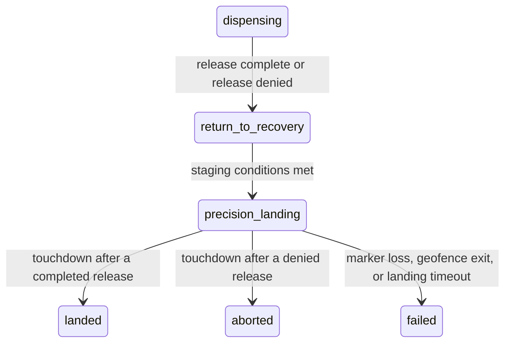
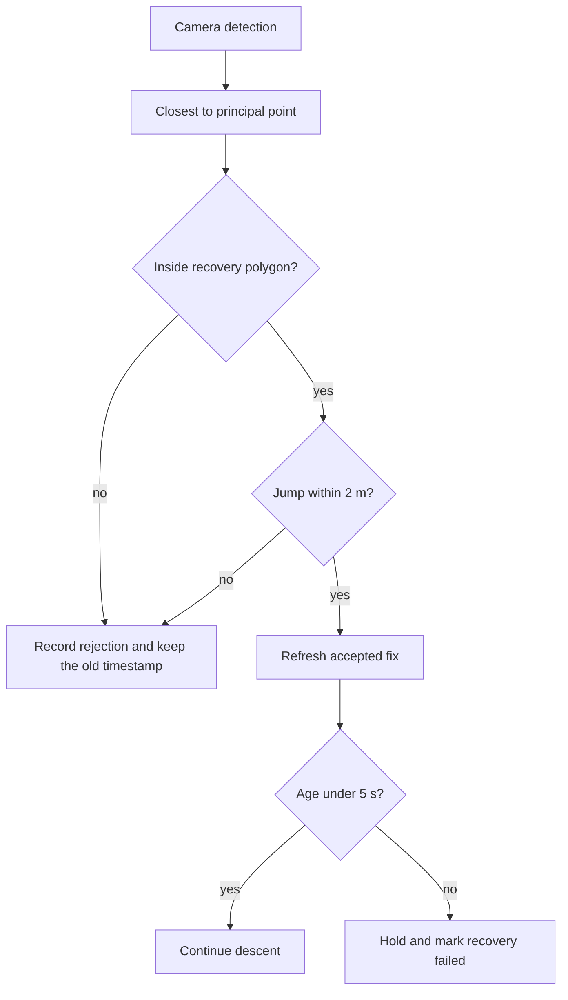
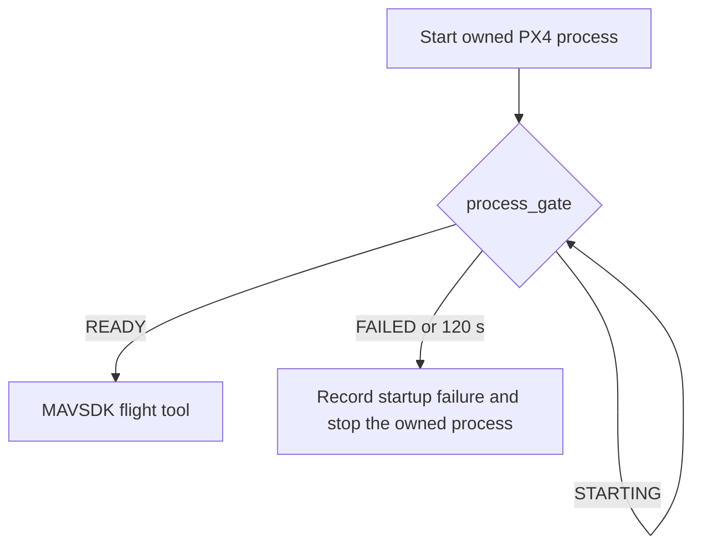

# Abort-to-recovery

A denied payload release and a safe landing are different results. The orchestrator records them separately in `outcomes`:

| Field | Meaning |
| --- | --- |
| `release_result` | `authorized`, `denied`, or `not_released` |
| `mission_execution_result` | `completed`, `aborted_release`, `failed`, or `in_progress` |
| `recovery_result` | `landed`, `failed`, or `in_progress` |

A traffic denial that then lands is `denied` / `aborted_release` / `landed`. `mission_result` remains `aborted_recovered` for that case. `operational_approval` stays false.

Latest PX4 SITL subset, one run each, stamp `20261013T055355Z`: nominal completed and landed (0.141 m, marker 9, 77 samples). Traffic conflict denied the release with 0 samples and landed (0.063 m, marker 4). Clearance expiration denied the release with 0 samples and landed (0.062 m, marker 4). Those reports also list `offboard_lost` because PX4 land mode is entered by stopping OFFBOARD. One run each is not a statistical sample. No physical flight.

## What the earlier flights showed

The nominal sortie completed. Touchdown was 0.155 m from marker 4. All five release gates were authorized.

The traffic-conflict sortie denied the release (`traffic_conflict_detected`, 0 samples) and returned to the recovery area. During the final descent the geofence rejected a 0.6 m/s downward velocity as `predicted_command_exit`. The vehicle was already inside the recovery polygon, over marker 4, and slightly below the recovery floor of 0 m. PX4 had not yet reported landed. The nominal flight avoided that rejection because the land detector fired first.

The clearance-expiration sortie also denied the release (`simulated_clearance_expired`, 0 samples). Descent then used a marker fix whose age ran from about 2.3 s to the 5 s timeout, and the flight faulted `marker_lost`. Several detections were rejected as `marker_outside_recovery`. The logged marker id was the largest detection in the frame, which is not always the marker under the camera. The 5 s timeout was not increased.

## Recovery states

The orchestrator does not add a second state machine. Release abort uses the existing return:



Each transition records time, reason, position, velocity, estimator validity, and the controller owner.

Staging is unchanged: horizontal distance at most 5 m, altitude 16–20 m in the SITL profile, horizontal speed at most 1.5 m/s, and valid position and attitude. The three earlier flights handed off inside that gate. The gate was not loosened.

## Touchdown lag

The traffic flight's geofence trace shows the vehicle reached 0.57 m, then -0.07 m, then climbed back to 1.4 m. The marker fix aged out during that bounce, above the 1 m band, so a check only at the timeout instant did not apply. After descent has once placed the vehicle inside 1 m of the accepted marker and inside the 1 m altitude band, the orchestrator stops OFFBOARD setpoints and requests PX4 land mode. Holding that position in OFFBOARD left the vehicle sitting on the marker with `landed` never set. A later bounce does not resume the descent. The 5 s timeout is unchanged and still fails a descent that never reached that band.

## Marker faults

`PrecisionLand` names the failure from the state it was in:

| Reason | When |
| --- | --- |
| `marker_never_acquired` | Lost before an accepted approach |
| `marker_stale` | Lost during approach after a fix was accepted |
| `marker_lost_during_descent` | Lost during descent |

A new detection more than `max_fix_jump_m` (2 m) from the accepted fix is `marker_outlier_rejected` and does not refresh the timestamp. After a timeout the lander holds. A later detection does not resume the descent.

The SITL camera now feeds the detection closest to the principal point. Size is only a tie break. A marker whose solved position is outside the recovery polygon is still rejected.



## PX4 startup

The launcher records the pid of the PX4 process it started. `process_gate` returns:

| State | Meaning |
| --- | --- |
| `NOT_STARTED` | No live process, and no fresh log |
| `STARTING` | Process alive, success line not yet in a log written after launch |
| `READY` | That process is alive and the success line is in a log written after launch |
| `FAILED` | The process exited |

A success line in an older log is `NOT_STARTED`. `assess` adds `CONNECTED` when MAVSDK is up and `READY` only after a fresh telemetry sample. On timeout the script stops that process group only.



## Reproduce one flight

```bash
SCENARIO=traffic_conflict TIMEOUT=360 LOG_DIR=/tmp/recovery_traffic \
  bash scripts/run_integrated_seeding_sitl.sh
```

`SCENARIO` may be `nominal`, `traffic_conflict`, or `clearance_expired`. The report is `$LOG_DIR/report.json`. Read `outcomes` in `orchestrator_evidence` for the three results. Do not overwrite `evidence/integrated_seeding/sitl_report.json`.

## Known limitations

- The 1 m pad radius is the distance at which descent hands off to PX4 land mode. It is not a measured land-detector specification. The 5 s marker timeout is unchanged.
- Marker reacquisition after a timeout is not implemented. Descent does not resume automatically.
- An OFFBOARD position hold at the surface does not make PX4 report landed. The handoff stops OFFBOARD and uses PX4 land mode.
- Startup `CONNECTED` and telemetry `READY` are tested as pure functions. The shell waits on the process gate. The flight tool still waits for MAVSDK itself.
- The successful subset is one nominal, one traffic-conflict, and one clearance-expiration run. The 18-run list was not executed.
- No physical flight has been performed.
