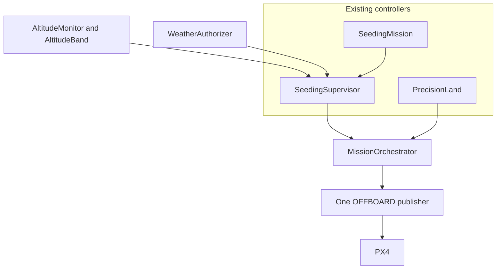

# Integrated seeding sortie

The orchestrator runs one seeding release and then hands trajectory ownership to the existing precision-landing controller. It does not replace either controller, and it does not publish a second stream of PX4 setpoints.

Validation of the pieces:

| Piece | Status |
| --- | --- |
| State machine, ownership, release gates, marker-loss hold | UNIT TESTED |
| Seeding law, altitude authorization, weather authorization, precision-landing law | UNIT TESTED (existing tests) |
| One headless PX4 / Gazebo flight of the whole sortie | See the SITL section below |
| Physical aircraft | PHYSICAL FLIGHT VALIDATED: no |

## Architecture

`MissionOrchestrator` is the only component that decides which behavior may command the vehicle. `SeedingMission` still computes the climb, hold, dispense, and return. `SeedingSupervisor` still applies the altitude band and the weather authorizer. `PrecisionLand` still runs the tracktor-beam search, approach, and descent. The orchestrator calls those objects and emits one `OrchestratorOutput` per tick. The SITL runner turns that output into one MAVSDK offboard setpoint. The ROS `precision_land` node is a separate publisher and must not be started during this sortie.



PX4 drops OFFBOARD if the control heartbeat stops. The orchestrator treats a gap longer than `offboard_gap_s` (default 0.5 s, the usual PX4 offboard loss window) as a recorded fault and still publishes on the next step. The unit test steps the clock across that gap. The SITL loop sends a setpoint about every 50 ms.

## State machine

States follow the seeding phases, then add a recovery stage and the precision landing:

`idle` → `preflight` → `takeoff` → `transit_to_release` → `hold_for_release` → `dispensing` → `return_to_recovery` → `precision_landing` → `landed`

A denied release uses the same return, and a successful precision landing after that denial ends in `aborted` with result `aborted_recovered`. That is not `completed`. `failed` is the terminal state for a fault that stops the sortie. Edges that are not in `ALLOWED` are rejected, leave the state unchanged, and record `invalid_transition`.

Every accepted transition stores source, destination, reason, simulated time, and context. Repeating the same state does not append another transition.

`hold_for_release` may return to `transit_to_release` if the vehicle drifts off the release station. That is the seeding law's existing climb retry, not a new flight mode.

## Setpoint ownership

Owners are `none`, `seeding`, `precision_land`, `hold`, and `px4_land`.

- Seeding owns the setpoint from takeoff through the return to the staging point.
- On a staging match the orchestrator stops calling the seeding law, confirms the simulated dispenser is closed, calls `PrecisionLand.activate`, and the next output is a precision-land setpoint. The previous tick was also a setpoint, so the heartbeat does not stop for a tick.
- `submit(claimant)` rejects any publisher whose name is not the active owner and records `ownership_conflict`.
- If the local position estimate is missing after preflight, the owner becomes `px4_land` and the output requests PX4 land mode. A position hold is not commanded without a position.
- If PX4 leaves OFFBOARD, the fault is `offboard_lost`, the recovery is to keep streaming setpoints, and the sortie continues.
- If the vehicle disarms while not landed, setpoints stop and the state is `failed` (`unexpected_disarm`).

## Release authorization

The orchestrator calls `SeedingSupervisor.step` and passes `landed=False`, so the seeding law cannot finish the flight by landing itself. The supervisor authorizes a release only when the altitude band and the weather authorizer both allow it, and only while the mission is in the dispense phase inside the release volume.

`require_weather` defaults to true. `false` is an invalid configuration: the sortie fails at start and does not open the dispenser. Weather decisions keep the provider's provenance. The SITL runner uses `StaticWeatherProvider` and `simulation_observation`, whose provenance is `simulated`. That observation is not a live METAR and `operational_approval` stays false.

A denial sets the mission reason, closes the dispenser on the seeding law's existing path, keeps samples already recorded, and goes to `return_to_recovery` (or `failed` if the modeled dispenser acknowledgement does not arrive). Later ticks do not open it again.

The dispenser has no airframe actuator. `dispenser_ack` defaults true, which models an immediate close. `false` records `dispenser_closure_failed` and does not start the return.

## Precision-landing handoff

Precision landing starts only when all staging conditions hold at the recovery point (the seeding profile's home, not the marker coordinate):

- horizontal distance at most `max_horizontal_m`
- altitude inside `min_altitude_m` .. `max_altitude_m`
- horizontal speed at most `max_horizontal_speed_mps`
- a finite position and a finite attitude quaternion

Elapsed time is not a staging condition.

`PrecisionLand` is unchanged: 5 s marker timeout, position hold with NaN velocity on loss, rejection of horizontal jumps larger than 2 m, and no descent resume until `activate` is called again. The orchestrator does not call `activate` after a marker-loss failure. Descent tag age is recorded from the land command. The 5 s timeout is the tracktor-beam value; it was not shortened after the earlier single-run observation that a fix reached 4.80 s.

The SITL staging altitude is 18 m, with a 16–20 m band, so the downward camera can see a marker near the field origin. The marker survey file is not read until after the flight.

## Faults

Each fault stores `code`, `time_s`, `mission_state`, `owner`, `recovery`, `result`, and the last position in local NED metres (simulated, estimated, source `px4_local_position`).

| Code | Recovery |
| --- | --- |
| `position_unavailable` | `nav_land` (PX4 land mode, no position hold) |
| `attitude_unavailable` | hold the last position and skip the camera update |
| `ownership_conflict` | reject the competing setpoint |
| `offboard_lost` | keep publishing; the caller reasserts OFFBOARD |
| `offboard_stream_gap` | publish on this step |
| `return_timeout` | position hold, `failed` |
| `marker_lost` | precision-land position hold, NaN velocity, `failed` |
| `dispenser_closure_failed` | position hold, `failed` |
| `landing_timeout` | position hold, `failed` |
| `unexpected_disarm` | stop setpoints, `failed` |
| `invalid_configuration` | `failed` before takeoff |
| `duplicate_enable` | ignore the second start |
| `invalid_transition` | keep the current state |

## Evidence

`MissionOrchestrator.evidence()` is schema 1, kind `integrated_seeding_sortie`. `mission_result` is `completed`, `aborted_recovered`, `failed`, or `in_progress`. The SITL tool adds `simulation_terminated` when the process times out or raises. A safe abort is `aborted_recovered` or `failed`, not `completed`.

The SITL report adds mission id, scenario id, PX4 version, the note that ROS was not used, touchdown position, marker ground truth, and horizontal error. Ground truth is scoring only.

## Configuration

SITL uses `sim_profile()` geometry (home at the origin, release at north 30 m, east 10 m, 15 m above the origin, local band 12–18 m) with `arrival_m=4` and `timeout_s=300`. The stock `sim_profile()` timeout of 60 s is left alone for the unit tests. The 15,000 ft profile is not flown.

`ref_alt_m` in the SITL altitude snapshot is the simulated weather station elevation (20 m), not PX4's GPS AMSL. Local NED still comes from PX4. That pairing keeps the surface observation applicable to a 15 m release. The report records the substitution.

## SITL reproduction

```bash
scripts/run_integrated_seeding_sitl.sh
```

The script copies `search_field` and `x500_search_cam` into the PX4 tree, starts headless SITL, and runs `tools/integrated_seeding_sitl.py`. The log and report default to `/tmp/integrated_seeding_sitl/`. PX4's `action.takeoff` climbs to 8 m. After that, only the orchestrator publishes offboard setpoints.

This script needs a built PX4 SITL binary, MAVSDK, OpenCV, and `gz_cam_sub` (`make cpp-build`). It is not part of `make test-fast`.

## Known limitations

- One publisher is an invariant of this process. A ROS `precision_land` or `offboard_mission` node started beside it will still fight for `trajectory_setpoint`.
- The geofence in `offboard_mission` is not applied to this sortie.
- The dispenser is simulated. Closure is the `dispenser_ack` flag, not an actuator acknowledgement from PX4.
- Weather in SITL is a static simulated observation. It is not a live forecast, and a passing decision is not an operational approval.
- Staging altitude and the camera footprint are tuned for `search_field`. A different world can stage inside the gate and still not see a marker.
- The earlier precision-land touchdown (marker 4, 0.098 m, 12.92 s, oldest fix 4.80 s) is one flight. It is not a statistical result, and it is not this integrated sortie.
- No physical flight has been done.

## SITL result

The result of the headless run is recorded in `evidence/integrated_seeding/sitl_report.json` when that file is present, and in the log directory of `scripts/run_integrated_seeding_sitl.sh`. Unit tests do not stand in for that flight.
