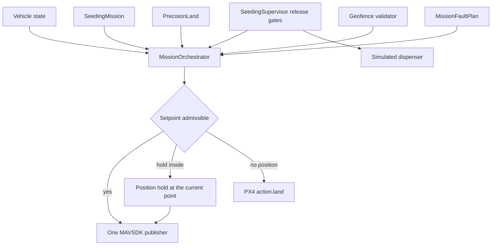
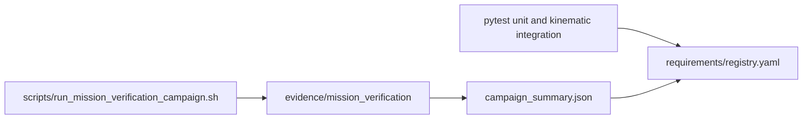

# Mission safety: keep-in, faults, and verification

The integrated sortie has one trajectory owner, `MissionOrchestrator`. The keep-in is evaluated there, on the current vehicle state and on the setpoint about to be published. `SeedingSupervisor` still authorizes the dispenser. Those are separate decisions. A geofence rejection does not rewrite the altitude, weather, airspace, traffic, or communications gate, and a release denial does not by itself move the fence.

This is a simulated verification aid. It is not a certified flight-safety system. No physical flight has been done.

## What each label means

| Label | Meaning |
| --- | --- |
| UNIT TESTED | A pytest case exercised the function on constructed inputs. |
| INTEGRATION TESTED | A pytest case stepped the orchestrator, supervisor, and precision-landing controller together on a kinematic plant. |
| SITL VALIDATED | PX4 SITL and MAVSDK flew the scenario and wrote a report for that run. |
| PHYSICAL FLIGHT VALIDATED | A real aircraft flew the scenario. Nothing in this repository has that label. |

A unit test does not make a requirement SITL validated. A skipped or failed test does not count as verified.

The baseline integrated flight (`evidence/integrated_seeding/sitl_report.json`) used Python, MAVSDK, and PX4 SITL. ROS 2 was not used on that flight. That report is one completed sortie before this keep-in was applied. Later campaign reports live under `evidence/mission_verification/` and are separate flights.

## Safety architecture



`offboard_mission` still owns a separate ROS geo-cage that clamps setpoints. That node is not started beside the orchestrator. The mission keep-in reuses `Fence` corner order through `GeofenceConfig.from_fence` and rejects an inadmissible command. It does not clamp.

## Coordinate frames

The horizontal frame for an enabled configuration is `local_ned`: x north, y east, metres. Geographic polygons are rejected. Local-to-geographic conversion is not independently validated in this repository.

Altitude is one of local, AGL, AMSL, or barometric. The configuration names the frame. The validator reads only that frame. Local height is `-z` in NED. AMSL is the configured reference plus local height, and only when both are finite. A missing reading is insufficient data, not a substitution from another frame.

The recovery polygon, when set, must lie inside the flight polygon. Inside it, the altitude floor is `recovery_min_altitude_m`. Outside it, the floor is `min_altitude_m`. The SITL recovery floor is -1 m so a touchdown estimate a few centimetres below the local origin remains inside that exception. Descent through the surface prediction is admitted only while the current point and the predicted point stay inside that recovery polygon and the vertical speed is downward.

## Boundary prediction

Prediction assumes constant velocity over `prediction_horizon_s`. It does not model acceleration or wind. Position uncertainty and, when present, velocity uncertainty widen the predicted point. The result is one of:

- current violation: the vehicle is already outside
- predicted violation: the constant-velocity point leaves the boundary
- uncertain proximity: the uncertainty disk reaches the boundary

A predicted violation is recorded. It does not, by itself, reject a hold that stays inside. A velocity command whose predicted point leaves the boundary is rejected.

## Setpoint validation

Before a heartbeat setpoint is published the orchestrator:

1. Evaluates the current state.
2. Checks the proposed position or velocity.
3. Requires the local NED frame named by the configuration.
4. Applies the margin.
5. Samples the segment from the vehicle to a position setpoint, so a notch between two inside endpoints is still a blocked route.
6. Chooses admit, hold at the current point, or PX4 land.

PX4 position setpoints may carry NaN velocity. Velocity setpoints may omit position. A NaN in the field that the mode is using is rejected. A rejection records the reason, the original command, the boundary, the vehicle state, the mission state, and the response. If the vehicle is inside or approaching and the position is finite, the published command becomes a hold at that point, so the vehicle is not left without a setpoint. If the position is invalid, the response is `action.land`. There is no position hold without a position, and there is no return across a blocked segment.

## Recovery

| Condition | Response |
| --- | --- |
| Command outside, vehicle still inside or approaching | Hold the current position. The orchestrator remains the publisher. |
| Position or altitude invalid | `PX4_LAND` via `action.land`. Mission state `FAILED`. |
| Return segment leaves the polygon | Same fallback. The home setpoint is not published. |
| Marker NED outside the recovery polygon | The detection is not passed to `PrecisionLand`. |
| Marker lost during descent | Existing precision-landing hold: NaN velocity, no further descent on the stale fix, re-activation required. |

## Fault injection

`MissionFaultPlan` is a simulated-clock schedule. It is not the visual-odometry fault rig under `faults/`. A fault opens on mission time, mission state, a transition, an evaluation count, or a named trigger. Weather and airspace faults make the existing authorizer `latest()` return a provider failure. The dispenser fault clears the simulated acknowledgement. There is no physical dispenser feedback in this loop.

| Scenario | Designed response |
| --- | --- |
| Nominal | Release, return, precision land, mission completed |
| Weather invalid during dispense | Dispenser closes, earlier samples kept, no later samples |
| Prohibited airspace during dispense | Same, through the airspace authorizer |
| Altitude invalid during dispense | Dispenser closes; primary reason is the altitude estimate |
| Release setpoint outside the keep-in | Setpoint rejected; mission does not complete |
| Position invalid | Not reported inside; PX4 land |
| Marker disappears in descent | `marker_lost`, no stale descent |
| Marker outside recovery | Detection rejected |
| Second publisher | `ownership_conflict`; the other claimant is refused |
| Sensor healthy again after an abort | Dispenser stays closed |

## Verification pipeline



`make test-fast` runs the pytest rows. It does not start PX4. `.github/workflows/sitl-campaign.yml` is `workflow_dispatch` and a weekly schedule. GitHub-hosted runners do not have PX4 SITL. The campaign script on a machine with PX4 writes one report per run. The summary uses those files only.

The default campaign is five runs: one nominal, one weather-during-dispense, one airspace-during-dispense, one geofence rejection, one marker loss. `CAMPAIGN=full` requests 17 runs. A run that does not happen is not verified.

## Campaign that was actually flown

Five headless flights, PX4 `v1.16.0-5-gd26cb57aca-dirty`, seed 0, ROS not used. Twelve of the seventeen requested runs were not started. This is not a population result and not a physical flight.

| Run | Result | What the report shows |
| --- | --- | --- |
| nominal | failed | 77 samples, 0.080 kg, return and descent. At the surface the marker fix aged out (`marker_lost`) at 0.119 m horizontal error. Not completed. |
| weather during dispense | aborted_recovered | 1 sample kept, reason `provider_failure`, dispenser stayed closed, touchdown error 0.057 m |
| airspace during dispense | aborted_recovered | 1 sample kept, reason `provider_failure`, touchdown error 0.021 m |
| geofence boundary | simulation_terminated | 967 release setpoints rejected (`setpoint_outside`). No release. No landing. |
| marker loss | failed | `marker_lost_during_descent`. PX4 then landed 12.169 m from the last marker. That distance is not a precision-landing error. |

Guided touchdowns in this campaign (the two recovered landings): mean 0.039 m, samples 2. The 95th percentile is not computed. Nominal completion rate is 0/1. Fault scenarios that were flown met their checks (4/4). Response latency on the two release faults was 0 s on the mission clock, meaning the denial was recorded on the evaluation that opened the fault.

Reports: `evidence/mission_verification/`. `campaign_summary.json` records the five flights. `campaign_results.json` is not written, because the nominal run missed its expectation. REQ-VERIFY-001 therefore stays unverified. A missing results file is not a pass.

## Reproduction

```bash
# five headless flights, each with its own PX4 SITL
bash scripts/run_mission_verification_campaign.sh

# seventeen flights
CAMPAIGN=full bash scripts/run_mission_verification_campaign.sh
```

Each flight needs the PX4 SITL binary, MAVSDK, OpenCV, and `gz_cam_sub`. The geofence-boundary run uses a 50 s mission timeout so the vehicle is not held for the seeding timeout.

## Known limitations

- Constant-velocity prediction has no wind and no acceleration.
- Geographic polygons are not implemented.
- The dispenser acknowledgement is software state.
- The campaign seed is 0. The scenarios are deterministic configurations, not a Monte Carlo sample.
- A handful of SITL runs does not establish population reliability.
- PX4 `action.land` is the fallback when a position hold is not justified. That mode is the firmware's land, not a path planned around the keep-in.
- No physical flight has been done.
