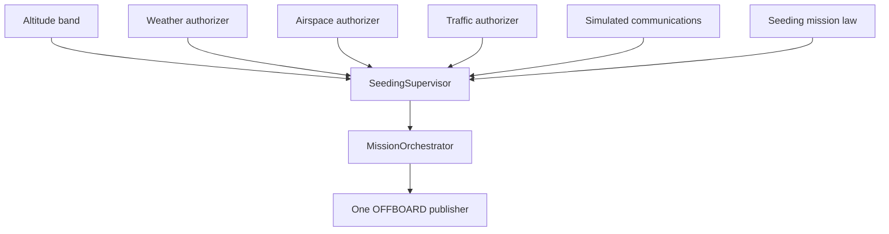

# Traffic and simulated communications

Traffic and simulated communications are the fourth and fifth release gates on `SeedingSupervisor`. The dispenser opens only when altitude, weather, airspace, traffic, and simulated communications all allow it, and only while the seeding law is in the dispense phase inside the release volume.

The primary abort reason is the first failing gate in that order. Later gates are still evaluated and stored. A denial closes the valve on the existing return path, keeps samples already recorded, and does not reopen the valve if the gate later recovers.

`operational_approval` stays false. This platform does not transmit on aviation radios, does not talk to ATC, and does not command an avoidance maneuver from a traffic track.



## Traffic model

A snapshot names its source, provenance (`simulated`, `recorded`, or `live`), clock, observation time, receipt time, and coverage. Coverage is a latitude/longitude center, a radius in metres, and an AMSL floor and ceiling. An empty track list authorizes release only inside that coverage. The decision still sets `surveillance_complete` false: a feed cannot prove that every aircraft was seen.

Each track has an identifier, observation and receipt times, source, WGS84 position, an explicit altitude frame, ground speed in metres per second, heading in degrees clockwise from true north, vertical speed in metres per second up-positive, and position uncertainty in metres.

AMSL on a track is compared with the vehicle's AMSL, which is local-origin AMSL plus local height (`ref_alt - down`). LOCAL on a track is local height above the same mission origin. Barometric altitude and AGL are rejected with `traffic_altitude_frame_unknown`. They are not converted.

`StaticTrafficProvider`, `SimulatedTrafficProvider`, and `RecordedTrafficReplayProvider` only read a cache. `latest` does not open a socket. There is no live ADS-B client. Replay accepts provenance `recorded` only.

## Conflict geometry

Separation numbers live on `TrafficLimits` and are labeled `simulation_only`. The defaults are 50 m horizontal, 30 m vertical, and a 30 s look-ahead. They are not regulatory minima.

For each valid track the monitor computes a constant-velocity closest approach in north, east, and up. `t_cpa_s` may be negative, which means the tracks are diverging or the closest point is already behind. A current conflict is horizontal and vertical separation both inside the simulation bubble. A predicted conflict is a non-negative `t_cpa_s` inside the horizon whose miss distance is inside the bubble. If position uncertainty is above `max_position_uncertainty_m` and the uncertainty disk reaches the bubble, the track is `traffic_uncertainty_exceeds_limit`.

Status values are `no_reported_conflict`, `potential_conflict`, `conflict_detected`, `insufficient_data`, and `invalid_traffic_data`. Any of the last four denies release. The flight controller keeps the existing PX4 climb, return, and precision-landing behavior. It does not add an avoidance trajectory.

## Simulated communications

`SimCommsBroker` is an in-process queue. A message can be delayed, dropped, duplicated, or delivered out of creation order. An outage blocks new deliveries. Message types are request, acknowledgment, advisory, simulated clearance, denial, cancellation, expiration, and communication failure.

A simulated clearance authorizes the communications gate only when all of these hold:

- the mission id is the policy mission (`sim-seeding` in the simulation helper)
- the release point is inside the clearance's latitude/longitude radius
- the release AMSL is inside the clearance altitude band
- mission time is before `expires_at_s`
- a later denial, cancellation, expiration, or outage has not removed it

A clearance for another mission, region, or altitude band does not authorize this release. Payload keys named like secrets are dropped before the record is stored. `transmitted` is false. `non_operational` is true. Nothing in this path sets `operational_approval`.

## Evidence

Supervisor evidence is schema 4, kind `seeding_release_authorization`. Schema 3 fields remain: altitude `decisions`, `weather_decisions`, and `airspace_decisions`. Schema 4 adds `traffic_decisions`, `traffic_snapshots`, `traffic_conflicts`, `traffic_source_metadata`, `communications_events`, `communications_decisions`, `simulated_clearance_records`, `authorization_summary`, and `mission_outcome`.

Conflict records carry units. Provenance is the snapshot's or the message's provenance. A simulation helper is `simulated`. A replayed snapshot is `recorded`. No traffic or communications path in this repository marks a record `live`.

Decision lists grow by one record per supervisor step, as weather and airspace already did. The communications broker keeps at most `max_retained` delivered messages (default 128). Traffic providers keep the segment list they were given.

## Tests

```bash
PYTEST_DISABLE_PLUGIN_AUTOLOAD=1 PYTHONPATH=src/px4_offboard python3 -m pytest \
  src/px4_offboard/test/test_traffic_authorization.py \
  src/px4_offboard/test/test_comms_authorization.py \
  src/px4_offboard/test/test_flight_management_scenarios.py \
  src/px4_offboard/test/test_seeding_supervisor.py \
  src/px4_offboard/test/test_airspace_authorization.py \
  src/px4_offboard/test/test_weather_authorization.py \
  src/px4_offboard/test/test_mission_orchestrator.py -q
```

Kinematic scenarios A–J live in `flight_management_scenarios.py`. They do not start PX4.

## SITL

`scripts/run_integrated_seeding_sitl.sh` still flies the low-altitude profile in `search_field` and is the only OFFBOARD publisher. The Python tool accepts `--scenario`:

| Scenario | Intended release result |
|---|---|
| `nominal` | Dispense, then precision land |
| `altitude_denial` | No release; altitude band is 1000–1100 m |
| `weather_denial` | No release; simulated wind is over the limit |
| `airspace_denial` | No release; prohibited volume covers the field |
| `traffic_conflict` | No release; a simulated track sits on the release point |
| `clearance_expired` | No release; the simulated clearance expires at 1 s |

```bash
scripts/run_integrated_seeding_sitl.sh
python3 tools/integrated_seeding_sitl.py --scenario traffic_conflict --report /tmp/integrated_seeding_sitl/traffic.json
python3 tools/integrated_seeding_sitl.py --scenario clearance_expired --report /tmp/integrated_seeding_sitl/clearance.json
```

The shell script starts PX4 itself. The Python tool expects PX4 to already be running. A report is PX4 SITL evidence only when that process actually flew. A kinematic scenario is not a substitute.

## Limitations

ADS-B-like tracks are not complete surveillance. Feeds can be late or missing, and missing data denies release rather than meaning the air is empty. The conflict monitor does not steer the vehicle. A simulated clearance is not a clearance from ATC. An airspace chart does not by itself grant permission to operate. This repository is not a certification artifact for flight outside simulation.
